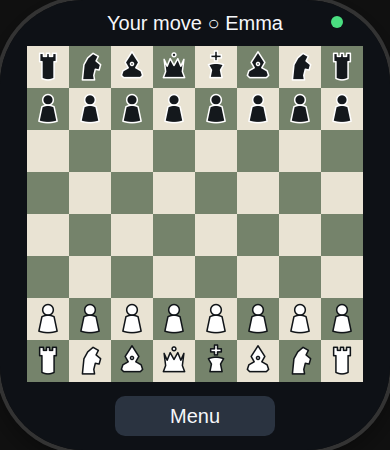
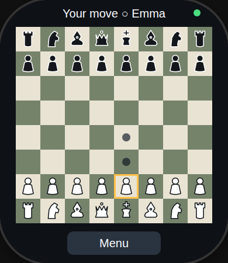
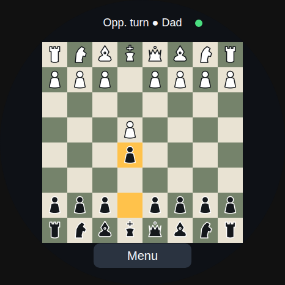
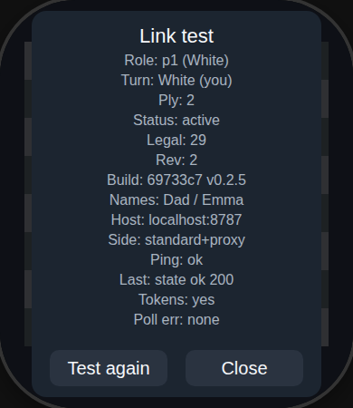

# Chess Watch

Two-player chess between an Amazfit Bip 6 and an Amazfit Active 3 Premium,
relayed by a Cloudflare Worker + Durable Object. The Worker is the single
source of truth; the watches are thin tap-to-move clients (tap a piece,
then a target square — no drag). Full rules on the Worker: castling,
en passant, promotion, check, checkmate, stalemate, insufficient material,
threefold / 50-move claims, fivefold / 75-move auto-draws, resignation,
draw agreement. "Start over" and "move back" need opponent confirmation;
resign is immediate. Browser development through `zepp-web-runner`
(`make web`).

## Screenshots

From the web harness (`make web`, local Worker) — the same
`page/index.js` that runs on the watch.

| Bip 6 — start | Bip 6 — piece selected |
|---|---|
|  |  |
| Active 3 — mid-game (flipped) | Bip 6 — Diagnostics |
|  |  |

Moves are optimistic: tapping a dot moves the piece at once, and the
board never goes dark while the send is in flight (see
`docs/design.md`).

## Quick start

1. `make setup` — installs root + web + worker, copies `.env.example` →
   `.env` and `worker/.dev.vars.example` → `worker/.dev.vars`. (On
   Arch/Omarchy it sets `SHARP_IGNORE_GLOBAL_LIBVIPS=1` so `sharp` uses
   its bundled binary instead of the system libvips.)
2. Generate two tokens:
   `python3 -c "import secrets; print(secrets.token_urlsafe(32))"` (twice).
   Fill in `.env` — `CHESS_SERVER_URL` (the Worker URL), both tokens,
   and the player names (`CHESS_P1_NAME` / `CHESS_P2_NAME`) — and put
   the SAME tokens and names in `worker/.dev.vars`. The deploy passes
   the names to the Worker (see § Deploy in `worker/README.md`); the
   `wrangler.toml` defaults (Aurora/Sam) are only a fallback.
3. `make worker-login` (first time only — authorizes wrangler in your
   Cloudflare account), `make worker-secrets` — set the production
   tokens (interactive), `make worker-deploy` — deploy the Worker
   (route from `CHESS_SERVER_URL`); or `make worker-dev` for local
   testing on `http://localhost:8787`. No global wrangler install
   needed — the make targets and `cd worker && npx wrangler <cmd>` use
   the local one. See "Cloudflare dashboard checklist" below for the
   dashboard half of the deploy.
4. Register the app in console.zepp.com and put the numeric `appId` in
   `app.json` (already `1137599` — only needed when starting from scratch).
5. `make config` — generate `shared/config.generated.js` from `.env`.
6. `make web` — test in the browser (`?player=p1` / `?player=p2` tabs).
   It points the harness at the local Worker dev server by default; run
   `make worker-dev` in another terminal first. To use the deployed
   Worker instead: `CHESS_SERVER_URL=<your Worker URL> make web`.
7. `make preview` — scan the QR with the Zepp app on each watch, enable
   developer mode.

`make test` runs the root JS vitest suite and the worker unit tests;
`make worker-test` adds the workerd integration suite. `make pieces` /
`make icons` regenerate the PNG assets.

## Cloudflare dashboard checklist

Do these at [dash.cloudflare.com](https://dash.cloudflare.com) (details
in `worker/README.md` § Deploy + cutover):

- **Account + login:** the custom domain must be a Cloudflare zone (DNS
  managed by Cloudflare). `make worker-login` authorizes wrangler; check
  it with `cd worker && npx wrangler whoami`.
- **Workers & Pages → chess-watch:** after `make worker-deploy`, check
  the deployment is listed and the version is 0.2.1. Settings →
  Variables → Secrets shows `CHESS_TOKEN_P1` / `CHESS_TOKEN_P2`
  (the dashboard alternative to `make worker-secrets`); Settings →
  Variables (plain Variables, not Secrets) holds `CHESS_P1_NAME` /
  `CHESS_P2_NAME` — the dashboard alternative to the `--var` flags
  `make worker-deploy` passes from `.env`; Settings →
  Triggers → Routes shows the custom-domain route (the alternative to
  the `--route` the deploy script passes). Observability → Logs (or
  `make worker-logs`) is where runtime errors surface.
- **Durable Object:** after the first real request, Workers & Pages →
  Durable Objects lists the `ChessGame` namespace — that is where the
  game lives; a redeploy keeps it (DO SQLite survives).
- **Cutover (only if the old tunnel setup still exists):** DNS → delete
  the tunnel CNAME for the custom domain; Zero Trust → Access →
  Applications → delete the Chess Watch app and its Service Auth policy;
  Zero Trust → Access → Service Auth → Service Tokens → delete the
  service token; on the laptop, stop/disable `cloudflared-chess-watch`
  and delete the tunnel.
- **Verify:** `curl $CHESS_SERVER_URL/api/v1/health` →
  `{"status":"ok","version":"0.2.1"}` (also check the workers.dev URL
  first, before the route attaches).

## Repo layout

`app.json` / `app.js` — Zepp app entry (Bip 6 + Active 3) · `page/` — watch
page · `app-side/` — side service, the only place that does fetch ·
`shared/` — protocol, FEN parser, HTTP client, version · `utils/` — role
storage, haptics · `images/pieces/{s,r}/` — generated piece PNGs ·
`assets/default.{s,r}/` — app icons · `web/` — Vite + React harness ·
`worker/` — Worker + Durable Object backend · `scripts/` — generators,
deploy · `docs/` — protocol, design, manual-test

## How the backend works

`worker/src/index.js` checks the config, authenticates the Bearer token,
and routes to the `ChessGame` Durable Object (`worker/src/game-do.js`),
which holds the game in memory (live chess.js board loaded from the
stored FEN) and persists it in DO SQLite; rules live in
`worker/src/rules.js` (including the persisted repetition map — chess.js
1.4.0 has no fivefold/75-move APIs and its threefold check is false
after a FEN load). Full detail, including the free-tier duration caveat
(a pending long-poll keeps the DO non-hibernatable), is in
`worker/README.md` and `docs/design.md`.

## Still offline on the watch? Read the Diagnostics screen

On the watch: Menu → **Test link** (or the Test link button on the
"Connecting…" screen). It runs a live probe through the side service and
shows where the link breaks — no tokens are displayed. Report the lines
verbatim; the table below is what they mean.
| What the screen shows | Meaning | Fix |
|---|---|---|
| `Build:` older than HEAD, or `Names: Aurora / Sam` when `.env` says otherwise | Stale install | `make preview` again and reinstall; check the Build line changes |
| `Host: localhost…` / `127.0.0.1` | Stale build baked with a dev URL | Same — the watch cannot reach localhost |
| `Poll err: 1` / `Diag: side unreachable` | Page never reached the side service (ZML BLE shake timed out after 5 s) — phone side, not code | Keep the Zepp app open, Bluetooth on, reinstall via a fresh `make preview`; then check the Side Service log screen — see `docs/manual-test.md` |
| `Ping: ok` + `Last: state unauthorized` | Tokens differ between `.env` and the Worker secrets | Copy the same tokens into both (`make worker-secrets`) and rebuild |
| `Ping: FAIL` + `Last: state timeout` / `network` | Phone has no route to the Worker, or the Worker is down | `curl $CHESS_SERVER_URL/api/v1/health` from a laptop; `make worker-logs` |
| `Ping: ok` + `Last: state ok` but the board stays offline | Poll failing after a good ping (BLE flakiness, stale revision) | Wait through a retry cycle; the `Last` line after the next poll is the new evidence |
| `Turn:` shows the other color, or `Legal: 0`, when you expect to move | Not your turn — or the wrong role (both watches picked the same player) | Check the Role line on both watches; Menu → Switch player on the one that is wrong. The other watch should show the opposite turn |
| `Last: move timeout` (or another code) right after a tap that did nothing | The move never reached the Worker (lost BLE response — the page now times out after 25 s instead of hanging) | Re-run Test link AFTER attempting the move, so `Last` shows the move outcome, and report the lines verbatim |
| `Names: Aurora / Sam` on the board while Test link shows the right names | The Worker was deployed without the names — `wrangler.toml` defaults win when no `--var` is passed | `make worker-deploy` again (it passes `CHESS_P1_NAME` / `CHESS_P2_NAME` from `.env` on every deploy) |

The Worker can be fine while the watch is offline — the CLI health check
only proves the Worker side. The Diagnostics screen is the only evidence
about the watch → phone → Worker path.

## Security note

Player bearer tokens are embedded in the bundle and extractable. Do not
distribute the build; rotate by editing `.env` and the Worker secrets and
rebuilding both watches. The Worker only answers with a valid player
token (and returns 500 `config_error` if the secrets are missing or are
still the placeholders).

## Verification status (2026-11-21)

Verified: worker unit tests 70/70, integration tests 4/4 (real workerd +
SQLite), JS vitest 57/57 (incl. 4 controller timeout tests, 6 board tap
tests — the topmost widget at every square centre has a tap path — 5
`positionChanged` tests, 3 overlay tests incl. the backdrop tap, 10
`applyMoveToFen` tests verified byte-for-byte against chess.js, and 4
optimistic-move tests), `vite build` pass, `zeus build` pass (0.2.5,
all 4 targets), headless-Chromium screenshots of both presets (see
above), a browser tap e2→e4 reaching the local Worker (ply 1, turn b),
a slow-tap regression in the harness (select e2, wait 45 s past two poll
timeouts, tap e4 → the move lands and the dots stay visible; before the
fix the dots vanished and the tap did nothing), preset switching Bip 6 ↔
Active 3 (board re-renders both ways), Menu → Test link opening the
Diagnostics overlay on both presets, including with the Worker down, and
the optimistic move with a 2.5 s delayed move response (the pawn is on
e4 while the server still says ply 0, no dim overlay) plus a forced 409
(the board rolls back to the old position and a toast appears). The
deployed Worker is healthy
(`/api/v1/health` → `{"status":"ok","version":"0.2.1"}`) and the
tunnel/DNS cutover is done.

Verified on-device: the 0.2.4 build is installed on both watches and
plays correctly. Not yet verified on-device: the 0.2.5 build (optimistic
moves, no black screen after a tap) — see `docs/manual-test.md`. Also
unconfirmed: Vibrator availability, console icon acceptance.
